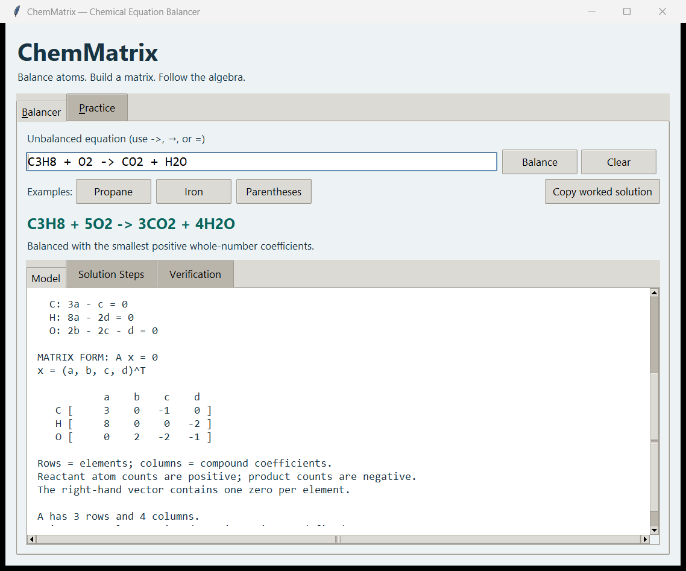
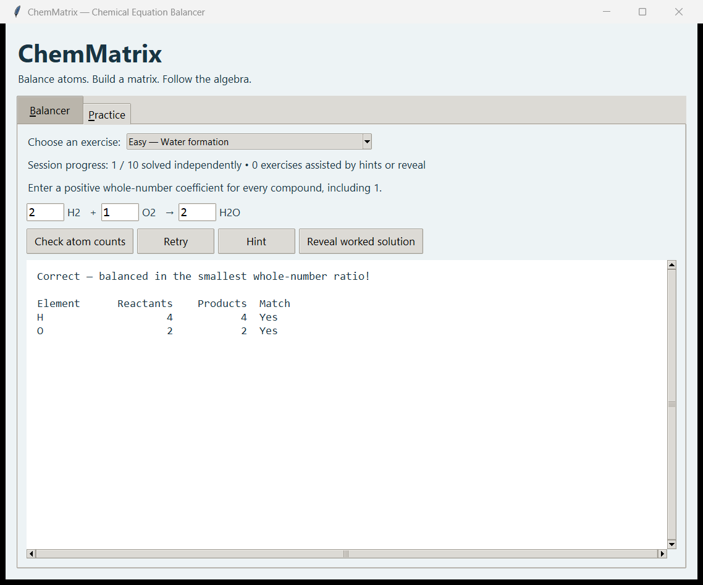

# ChemMatrix

An offline Tkinter app that balances chemical equations by solving a homogeneous
linear system with exact fractions. Built for a linear algebra final project.

**Five features:** equation input, automatic conservation matrix, step-by-step
Gauss–Jordan elimination, atom-count verification, and ten practice exercises.





## Run on Windows

Use Python **3.10 or newer** with Tcl/Tk support. This project was checked with
Python 3.13 and Tk 8.6 on Windows.

Open PowerShell in the repository:

```powershell
python --version
python -m tkinter
python main.py
```

The Tkinter command opens a small diagnostic window; close it before launching
ChemMatrix. No pip installation is needed. `requirements.txt` documents that all
runtime modules are part of the standard library.

Optional isolated environment (activation is unnecessary):

```powershell
python -m venv .venv
.\.venv\Scripts\python.exe -m pip install -r requirements.txt
.\.venv\Scripts\python.exe main.py
```

If `python` is unavailable, try `py` or install Python with the **Tcl/Tk and IDLE**
component enabled. If `_tkinter` is missing, modify/reinstall Python to include
that component; `pip install tkinter` is not the fix. On Linux, Tk may require
the operating system's Python Tk package and a graphical desktop session.

## Use the app

1. Enter an equation without leading coefficients, or select an example.
2. Select **Balance** or press Enter in the equation field.
3. Read the **Model**: variables, conservation equations, and labeled matrix.
4. Open **Solution Steps** and use Next/Previous to follow each row operation.
   The final step explains free variables and integer normalization.
5. Open **Verification** to compare atom totals and the zero residual vector.
6. Select **Copy worked solution** to copy all views and all row operations.

Editing the equation immediately clears the previous result. Clear empties the
input. Tab moves between controls; Ctrl+Tab switches notebook tabs; Enter in a
practice coefficient field checks the answer. Output can be selected and copied,
and both horizontal and vertical scrollbars are available.

In **Practice**, choose an exercise by difficulty, enter every coefficient
(including 1), and check atom counts. A proportional answer is balanced but needs
reduction before it counts as solved. Retry clears the fields. Hint and Reveal
mark that exercise as assisted for the session; a later answer on that exercise
does not earn an independent completion. An exercise already solved independently
retains that achievement if a hint is viewed afterward. Progress resets when the
app closes; changing exercises clears the coefficient fields.

## Supported input

```text
C3H8 + O2 -> CO2 + H2O
Fe + O2 → Fe2O3
Ca(OH)2 + HCl = CaCl2 + H2O
Al + H2SO4 -> Al2(SO4)3 + H2
```

- Use case-sensitive element symbols and ordinary digits: `Co` and `CO` differ.
- Parentheses and repeated elements are supported, including `CH3COOH`.
- Whitespace is allowed around compounds and separators, not inside formulas.
- Leave out coefficients, ionic charges, hydrate dots, square brackets, and state
  labels such as `(aq)`. The app gives a correction message for unsupported input.
- Limits: 500 input characters, 12 compounds total, 12 distinct elements, four
  nested parenthesis levels, and each explicit subscript from 1 to 999 without
  leading zeros. Practice entries allow up to six digits.

The app checks syntax, element symbols, and atom conservation. It does not check
valence, predict products, or establish that a reaction occurs.

## The linear algebra

Each element produces one equation. Each compound contributes one unknown
coefficient. Reactant counts enter positively and product counts negatively:

```text
A x = 0
```

For propane, three element equations give a 3×4 matrix with rank 3 and nullity 1.
Its nullspace is spanned by `(1/4, 5/4, 3/4, 1)`. Multiplying by 4 gives the
smallest integer ratio `(1, 5, 3, 4)`.

Rectangular matrices have no determinant. For a square matrix, a zero determinant
means a nontrivial nullspace exists; positive coefficients still need checking.
See the [worked mathematical model](docs/mathematics.md).

The solver reports four explicit outcomes:

| Status | Meaning |
| --- | --- |
| `balanced` | One free variable yields strictly positive coefficients. |
| `zero_only` | Full column rank; only the zero vector solves the system. |
| `no_positive` | The one-dimensional solution requires a zero or mixed signs. |
| `multiple_free` | The general solution has multiple parameters; no automatic balance is selected. |

`C + O2 -> CO + CO2` demonstrates the last case. Multiple free variables do not
mean balancing is impossible; this version deliberately presents the family.

## Tests

```powershell
python -m unittest discover -s tests -v
python -m compileall -q chemmatrix main.py tests
```

Tests cover parsing, input boundaries, exact elimination, replay of row operations,
normalization, exceptional systems, practice feedback, and real Tk widgets. The
GUI tests briefly open windows and use the clipboard. They skip if Tk cannot open
a graphical session. To run just the math checks:

```powershell
python -m unittest tests.test_core -v
```

See [validation notes and the manual checklist](docs/validation.md).
The repository also includes a Windows GitHub Actions workflow for core checks
on Python 3.10 and 3.13; graphical widget checks run locally.

## Repository guide

```text
main.py                  Application entry point
chemmatrix/
  parser.py              Neutral formulas, equation structure, limits
  matrix.py              Exact RREF and recorded elementary operations
  solver.py              Conservation matrix, coefficient derivation, verification
  explanation.py         Teaching text and clipboard export
  practice.py            Ten exercises and answer feedback
  gui.py                 Tkinter/ttk interface
tests/                   Standard-library unit and widget integration tests
docs/
  mathematics.md         Worked model and core function contracts
  assignment-checklist.md
  report-draft.md         Editable report with group-member placeholders
  presentation-script.md Timed 3–5 minute demo script
  validation.md
  images/                Actual application screenshots
requirements.txt         Standard-library-only dependency declaration
```

## Submission preparation

The supplied handout lists traffic, electrical circuits, economics, and software
engineering systems. **Chemistry-topic acceptance remains unconfirmed.** The
[assignment checklist](docs/assignment-checklist.md) records that distinction.

The report and script are editable Markdown drafts. Fill in group details, format
the report to 2–3 pages, record a 3–5 minute video, and include the source code.
The earlier video supplied the presentation sequence; its circuit model is not
used as evidence for the chemistry model.
